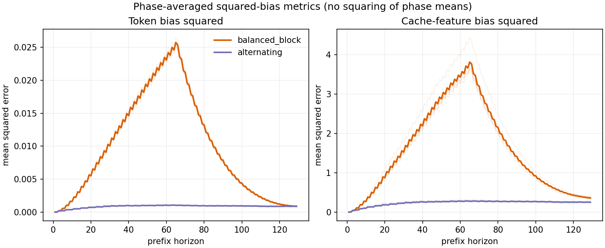

# Round 12: accumulated prefix bias tracks the sequence-risk gap

**Completed and retrieved.** The scientific run finished on 2026-10-12 at
05:31:21 UTC in 86.37 seconds (87.24 seconds including the supervisor).
All five original two-layer Round 6 histogram models, four fixed n=64
prefixes, two antipodal phases, and 64 Q-law paths per phase completed.
T=129 contains 64 generated-suffix pair-thinning events. Both policies
have 32 positive and 32 negative signs; their total budgets are identical.
No training occurred. The old prefix and START remain exact. This halves
the generated input pairs, not the entire cache.

Read the [frozen protocol](../../experiments/PROTOCOL_ROUND12_BALANCED_ORDER_V1.md),
[original generated report](../round12_balanced_order_v1_20261012T052457Z/REPORT.md),
and [recorded-evidence inspection](joint_bias_kl_review.json). The latter
is a post hoc descriptive analysis, not a new experiment, fitted predictor,
or predeclared scientific gate.

## Main result

All values below average phases and prompts equally within each training
seed, then average the five seeds. Bias quantities are expected squared
norms of the actual pathwise discrepancy, divided by logical cache mass
squared. Token discrepancy compares the compressed weighted histogram with
the full histogram of the same Q input history. Cache discrepancy compares
weighted K/V moments with full P replay of that same Q history, including
changes to later representations. These moments are not query-weighted
attention errors.

| Quantity | Balanced Block | Alternating | Block / Alternating |
|---|---:|---:|---:|
| Full-sequence KL(Q||P), T=129 | 1.201930 | 0.107638 | 11.17 |
| Terminal token-bias squared | 0.000894550 | 0.000862985 | 1.04 |
| Terminal cache-moment bias squared | 0.357706 | 0.250979 | 1.43 |
| Sum of prefix token-bias squared | 1.260970 | 0.110169 | 11.45 |
| Sum of prefix cache-moment bias squared | 203.154468 | 30.323530 | 6.70 |

The predeclared KL ordering and pooled local-distortion comparability
screens pass in 5/5 training seeds. Per-seed KL ratios are 10.15--12.94;
the event/layer-pooled local attention squared-error max/min ratio is
1.00194--1.00462. Per-layer ratios are at most 1.01705. These compare means,
not the complete local error distributions or vectors.

| Seed | KL ratio | Integrated token-bias ratio | Integrated cache-bias ratio |
|---:|---:|---:|---:|
| 11 | 11.1951 | 11.8302 | 6.4151 |
| 23 | 10.6817 | 10.9684 | 6.3355 |
| 37 | 11.2878 | 11.4310 | 6.8903 |
| 51 | 12.9399 | 12.3349 | 8.2134 |
| 71 | 10.1531 | 10.7922 | 5.8428 |

For each seed, KL ratio / integrated-token-bias ratio differs from one by
-5.92% to +4.90%. This is descriptive agreement of observed effect sizes,
not heldout prediction accuracy or an error bound. Terminal token-bias
ratios range from 0.90 to 1.21, so terminal bias is not exactly matched.

## What the trajectory explains

The first block contains coherent perturbations: real token and cache
bias build up. Reversing the signs reduces the current bias, but does not
remove sequence KL accumulated earlier. The full-sequence risk is

    KL(Q_1:T || P_1:T) = sum_t E_Q[KL(Q_t(.|Y_<t) || P_t(.|Y_<t))].

Each conditional term is nonnegative. Consequently, matching terminal
bias or terminal conditional distributions cannot cancel earlier terms.
The observed averages show this distinction directly:

| Prediction horizon | Block token-bias squared | Alt token-bias squared | Block conditional KL | Alt conditional KL | Block cumulative KL | Alt cumulative KL |
|---:|---:|---:|---:|---:|---:|---:|
| 65, final positive event of first block | 0.0257268 | 0.00103026 | 0.0243489 | 0.00101827 | 0.715011 | 0.0480366 |
| 97 | 0.00503986 | 0.000937223 | 0.00556655 | 0.000952625 | 1.121862 | 0.0788320 |
| 129 | 0.000894550 | 0.000862985 | 0.000968263 | 0.000858445 | 1.201930 | 0.107638 |

The first negative event occurs at prediction 67. The final sampled Y_129
is outside the measured terminal cache, which ends at Y_128.



Saved path trajectories provide a joint check beyond ratios between policy
means. Within each fixed model/prompt/phase, the descriptive Pearson
correlation between integrated token-bias squared and full pathwise
conditional-KL sum has median 0.986 for Block and 0.965 for Alternating
(ranges 0.976--0.993 and 0.882--0.989). The corresponding cache-moment
correlation medians are 0.994 and 0.983. These 40 cells per policy are
dependent across phases and are not independent scientific replications;
no p values or causal interpretation are assigned to them.

## Supported conclusion and remaining gap

The whole actual bias trajectory is a strong empirical explanation of the
policy risk difference in this histogram setting. Terminal sign balance
and terminal bias alone are poor explanations. Integrated token-composition
bias tracks the observed KL multiplier particularly closely; the coarser
KV moment norm tracks the ordering but not the full multiplier.

This does not identify bias as the sole mediator, establish a universal
scalar risk law, or isolate a temporal effect beyond actual bias. Queries,
directions, logit sensitivity and generated-history changes remain coupled.
The comparison changes policy order while preserving sign counts and budget;
it does not match every actual bias prefix or every local perturbation vector.
The full-sequence KL is Monte Carlo over Q histories, with exact categorical
conditional KL evaluation, not exhaustive-tree KL or policy-mixture KL.
The independent scientific units remain the five training seeds. Paired
path Monte Carlo SE of the Block-minus-Alternating KL difference is
0.0277--0.0296 within each seed, separately from seed variation.

The next strengthening remains the frozen protocol's same-horizon,
same-direction Fisher/full-unroll comparison. It should test whether
output-sensitive geometry quantitatively accounts for the risk gap,
rather than introducing a new fitted scalar proxy or treating these
descriptive correlations as a theorem. No next experiment was launched
during this result check. Earlier certification failures are unchanged.

## Evidence checks and reproduction

All 10,320 prefix rows, 10,240 event rows, 5,120 terminal path rows and
40 joint path files are present. The inspection checks frozen source hashes,
recorded checkpoint identities/quality, every prefix's physical record count,
mass and sign sum, common uniforms, generated/input alignment, KL cumulative
sums, histogram normalization and CSV/path agreement. Maximum CSV-versus-path
absolute mean discrepancy is 2.91e-11 (includes unnormalized feature energy);
maximum recorded layer-0 moment identity gap is 1.41e-13. The histogram
identity and pre-compression KL gaps are zero. This is software/evidence
validation, not formal theorem verification or numerical certification.

From repository root, write to a new output directory:

```text
python -B scripts/inspect_round12_result.py --run-dir runs/round12_balanced_order_v1_20261012T052457Z --output-dir runs/NEW_ROUND12_INSPECTION
```

The JSON records input-file and inspection-source hashes. Larger joint
`paths/*.npz` files are secondary evidence; read the compact tables first.
